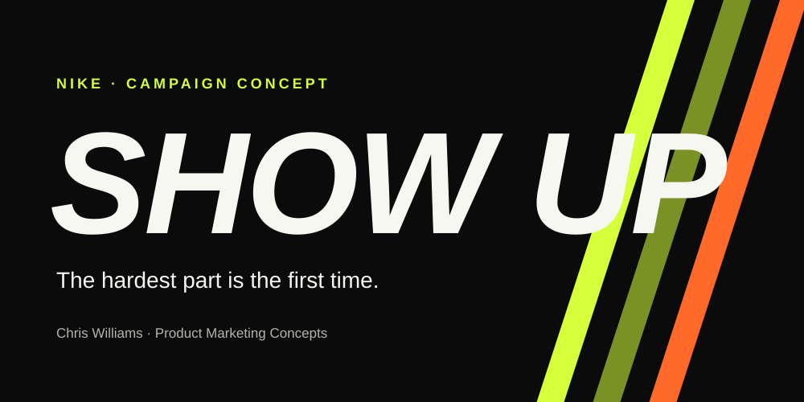
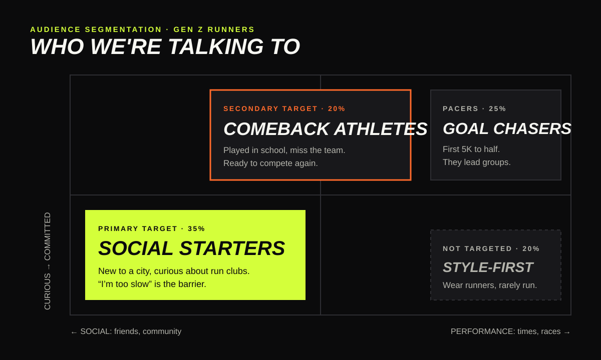
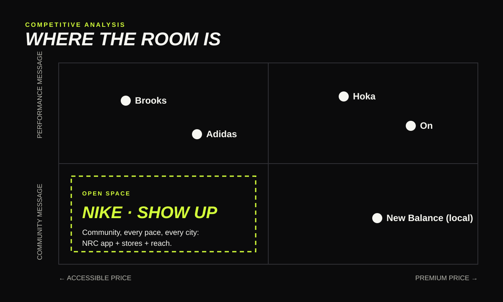
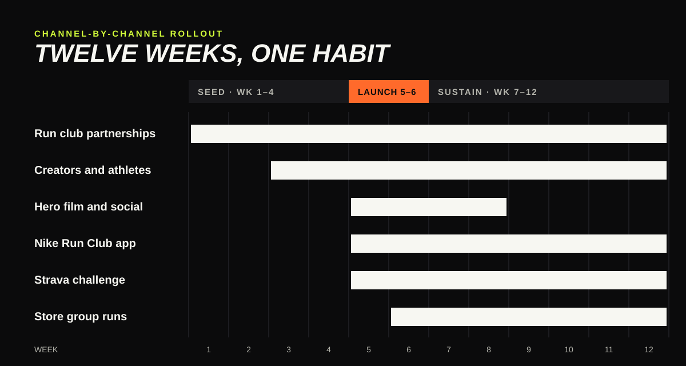

# Nike "Show Up": Campaign Concept 👟

<kbd>
    
</kbd>

## Project Description 🎨

A campaign concept for Nike built on one insight: *the hardest part of running isn't the miles, it's showing up the first time.* Run club participation jumped 59% in 2024 and Gen Z is joining for friends, not finish times, while challengers like Hoka and On win runners with product stories. **Show Up** puts Nike on the side of the run club: it segments Gen Z runners to find the ones who haven't picked a brand yet, maps the competition to find the open space, and rolls out across six channels over 12 weeks, with the Pegasus as the shoe for every pace in the group. It is one of Chris Williams's [Product Marketing Concepts](https://allsar2k.github.io/pmm-portfolio/concepts/).

**[View the concept site →](https://allsar2k.github.io/nike-campaign-concept/)**

## Screenshots:

    <kbd></kbd>
    <kbd></kbd>
    <kbd></kbd>

## Technologies Used 💻

### Frameworks
- [x] **Creative brief** — problem, insight, idea, objectives, mandatories
- [x] **Needs-based segmentation** — motivation × commitment
- [x] **Positioning map and SWOT** — where competitors stand and where the space is
- [x] **Phased channel plan** — seed, launch, sustain
- [x] **Funnel measurement** — saw → found → showed up → came back → bought

### APIs & Web Services
- [x] **GitHub Pages** — hosts the one-page concept site
- [x] **GitHub Actions** — checks the design system's colour contrast on every push

### Data Sources
- [x] **Strava Year in Sport 2024** — run club and Gen Z fitness trends
- [x] **On Holding 20-F, Deckers results** — On and Hoka growth
- [x] **Public brand marketing** — qualitative competitor positioning

## Architecture 🏗️

- **Pattern**: four documents that build on each other: brief → segmentation → competition → rollout
- **Design system**: [Night Run](docs/DESIGN.md), with tokens in `assets/tokens.json` and contrast checked by `scripts/check-contrast.mjs`
- **Graphics**: hand-written SVG with titles and descriptions
- **Site**: one static HTML page and one stylesheet, no JavaScript and no tracking
- **Target**: any modern browser; WCAG 2.2 AA

## Features 🌟

- 📝 **[Campaign brief](docs/01-campaign-brief.md)** — the problem, the insight and the "Show Up" idea
- 🧭 **[Audience segmentation](docs/02-audience-segmentation.md)** — Social Starters, Comeback Athletes, Goal Chasers, Style-First Wearers
- ⚔️ **[Competitive analysis](docs/03-competitive-analysis.md)** — Hoka, On, Adidas, New Balance, Brooks, and the open space
- 📣 **[Channel-by-channel rollout](docs/04-channel-rollout.md)** — clubs, film, NRC, Strava, stores, creators
- 🎨 **[Design system](docs/DESIGN.md)** — Night Run palette, type and pace lines

## Contributing ⚙️

Run with a club and see something we missed? Open an issue or fork the repository and send a pull request. Run `node scripts/check-contrast.mjs` before proposing colour changes.

## License 🪪

Site code is MIT licensed. Strategy documents and graphics © Chris Williams; see [LICENSE](LICENSE). This is an independent concept and is not affiliated with or endorsed by NIKE, Inc.

