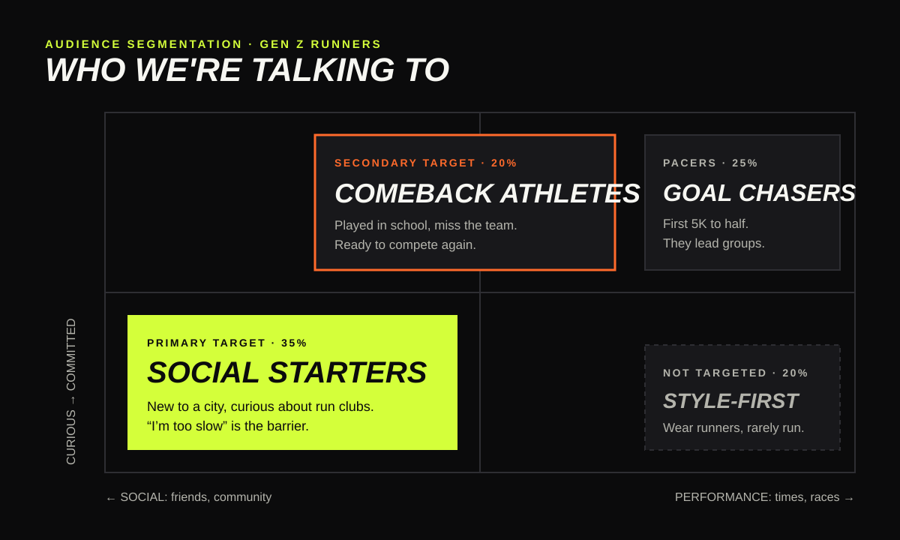

# 02 · Audience segmentation

Segments of 18–27-year-old (Gen Z) runners and would-be runners in the US, defined by **why** they run and **how committed** they are. Sizes are planning estimates for the concept, not measured data.

| Segment | Why they run | Commitment | Share of audience (est.) | Role in campaign |
|---|---|---|---|---|
| **Social Starters** | Friends, community, something to do after work | Curious → regular | 35% | **Primary target** |
| **Comeback Athletes** | Miss the team and the competition they had in school | Regular | 20% | **Secondary target** |
| **Goal Chasers** | First 5K, 10K or half marathon | Committed | 25% | Supporting: they lead the groups |
| **Style-First Wearers** | Wear running shoes, rarely run | Low | 20% | Not targeted: reached anyway through culture |

## Primary · Social Starters

- **Who:** 21–26, new to a city or a job, saw a run club on TikTok or Instagram and is half-curious.
- **What stops them:** "I'm too slow." "I don't know anyone." "I don't have the right gear."
- **What gets them there:** a friend going too, a club that says all paces welcome, a first run that ends with coffee.
- **Why they matter to Nike:** they haven't chosen a running brand yet. Hoka and On win runners who already care about cushioning and engineering; Social Starters choose the brand that welcomes them first.
- **Message:** *You don't have to be a runner. You just have to show up.*

## Secondary · Comeback Athletes

- **Who:** 22–27, played a high school or college sport, stopped after an injury or graduating, and misses being on a team.
- **What stops them:** comparing themselves to the athlete they used to be.
- **What gets them there:** structure, a crew, a reason to compete again (club 5Ks, relays).
- **Why they matter to Nike:** they already grew up in Nike gear and respond to sport language. The job is to bring them back, not to win them over.
- **Message:** *You never stopped being an athlete. Find your team again.*

## Supporting · Goal Chasers

They're already running and often already loyal to a brand. In this campaign they are **pacers and club leaders**: Nike equips them to host welcoming group runs, and their credibility brings the Social Starters in.

## Why not lead with Goal Chasers?

They're the obvious audience for a running shoe and the most contested one: Hoka, On, Adidas, Brooks and Saucony all speak to them with performance claims. Leading with community lets Nike compete where its scale (stores, the NRC app, athletes) matters most, and where challengers have less to say.
