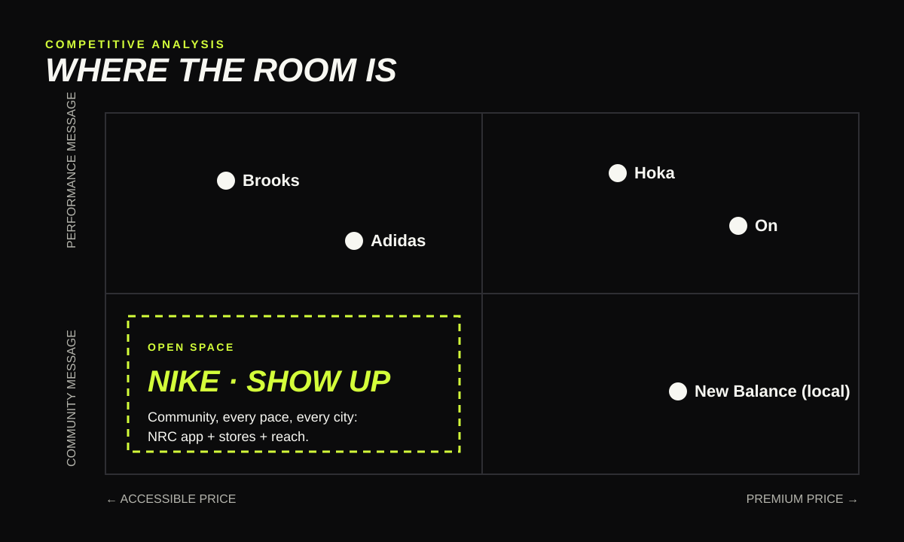

# 03 · Competitive analysis

## Who Nike is up against for new runners

| Brand | What they stand for | Recent momentum | Strength with Gen Z | Weakness this campaign exploits |
|---|---|---|---|---|
| **Hoka** | Maximum cushioning, comfort for every runner | ~$2.2B FY2025 sales, up ~24% (Zacks, 2025) | Comfort story, trend-driven style | Product-led: little to say about community |
| **On** | Swiss engineering, design-led | CHF 2.32B 2024 net sales, up 29% (On Holding, 2025) | Looks great off the run | Premium price; the brand feels more like a lifestyle label than a club |
| **Adidas** | Racing heritage (Adizero) and culture | Strong in lifestyle footwear | Terrace and fashion credibility | Running message focused on racing and records |
| **New Balance** | Heritage, "dad shoe" cool, run-specialty | Strong in lifestyle and running | Style credibility | Community efforts are local, not national |
| **Brooks** | Specialist running brand | Strong in run-specialty stores | Trusted by serious runners | Little cultural reach with beginners |

## Positioning map

| | Accessible price | Premium price |
|---|---|---|
| **Performance message** | Brooks, Adidas | On, Hoka |
| **Community message** | **Open: Nike "Show Up"** | New Balance (local) |

The community-and-accessible corner is empty at national scale. Nike is the only brand that can fill it everywhere at once, because of three assets the others don't have together:

1. **The Nike Run Club app**: free guided runs and a ready-made way to find and log group runs.
2. **Nike stores in every major city**: a place for clubs to start and finish runs.
3. **Scale in media and athletes**: the reach to make run clubs a national story, not a local one.

## SWOT for Nike in this space

| Strengths | Weaknesses |
|---|---|
| NRC app, stores, athletes, the Pegasus as a known everyday shoe | Seen by some runners as less specialist than Hoka or On |
| **Opportunities** | **Threats** |
| Run club boom, Gen Z seeking in-person community, comeback athletes | Challengers copying club activations; "corporate" run clubs feeling inauthentic |

## What this means for the campaign

- **Don't fight on foam.** A cushioning claim invites a direct comparison with Hoka on Hoka's terms.
- **Support clubs, don't replace them.** Partner with existing independent run clubs instead of launching Nike-branded clubs that compete with them; authenticity is the whole point.
- **Use the Pegasus as the "every pace" shoe**, the one the whole group can wear, not a racing flat.

## Sources

- On Holding AG. (2025). *Form 20-F for the fiscal year 2024*. https://www.sec.gov/Archives/edgar/data/1858985/000185898525000003/onholdingag-20241231.htm
- Zacks. (2025). *Hoka sales surge strengthens the bull case for Deckers stock*. https://www.zacks.com/stock/news/2809387/hoka-sales-surge-strengthens-the-bull-case-for-deckers-stock

Brand positions for Adidas, New Balance and Brooks are qualitative judgements from their public marketing, not measured data.
