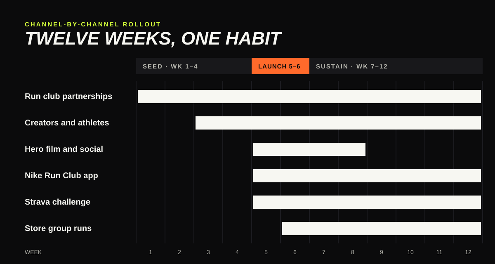

# 04 · Channel-by-channel rollout

## Phases

| Phase | Weeks | Goal |
|---|---|---|
| **Seed** | 1–4 | Recruit 60 independent run clubs in 10 US cities and equip their leaders |
| **Launch** | 5–6 | Release the "Show Up" film and make the first group run the call to action |
| **Sustain** | 7–12 | Turn one run into a habit with streaks, store runs and club challenges |

## Channel by channel

### 1 · Run club partnerships (weeks 1–12)

- 60 independent clubs across 10 cities, chosen for welcoming every pace.
- Leaders get Pegasus pairs, lights and vests for night runs, and a small budget for post-run coffee.
- Clubs keep their own names and identities. Nike appears as a supporter, never as the owner.
- **KPI:** new members per club per week.

### 2 · Hero film and social video (weeks 5–8)

- **"Show Up"**, a 60-second film following four real members on the walk, jog and nerves before their first group run. It ends on the coffee, not the finish line.
- Cut-downs for TikTok, Instagram Reels and YouTube Shorts, each featuring one club's real members in their own words.
- **KPI:** completed views, saves and shares; clicks to "find a run near you".

### 3 · Nike Run Club app (weeks 5–12)

- "First Group Run" guided run: a short audio session with a club leader for the walk to the meeting point and the first easy mile.
- A run club finder, with "all paces welcome" as a filter.
- **Show Up Streak:** a badge for joining a group run three weeks in a row.
- **KPI:** new 18–24 members; group runs logged; streak completion.

### 4 · Strava (weeks 5–12)

- A "Show Up" club challenge: join four group runs in a month.
- Partner clubs post their weekly runs as Strava club events.
- **KPI:** challenge joins and completions.

### 5 · Nike stores (weeks 6–12)

- Thursday-evening group runs leave from Nike stores in the 10 cities, led by partner club leaders. Stores hold bags, offer water and a place to stretch.
- Pegasus fit sessions before each run: try them on, run in them, decide afterwards.
- **KPI:** run attendance; Pegasus try-on to purchase rate.

### 6 · Creators and athletes (weeks 3–12)

- Creators who are themselves new to running document their first month in a club. Progress counts, speed doesn't.
- Comeback-athlete stories from former college athletes for the secondary segment.
- One well-known Nike athlete joins an unannounced Thursday run in each city. It's a surprise, not a headline.
- **KPI:** creator content engagement; earned media.

## Budget split (illustrative)

| Channel | Share |
|---|---|
| Run club partnerships and gear | 25% |
| Hero film production and paid social | 35% |
| NRC app features | 10% |
| Store events | 15% |
| Creators and athletes | 15% |

## Measurement

Weekly dashboard tracking the funnel **saw the film → found a run → showed up → came back**:

| Stage | Metric | Source |
|---|---|---|
| Saw | Completed views, reach among 18–27s | Social platforms |
| Found | Run club finder searches, Strava challenge joins | NRC, Strava |
| Showed up | Group runs logged, store run attendance | NRC, store counts |
| Came back | Members with 3+ group runs in 60 days | NRC |
| Bought | Pegasus sales to 18–24s in campaign cities vs. control cities | Nike sales data |
